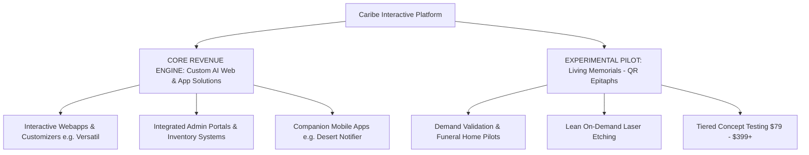
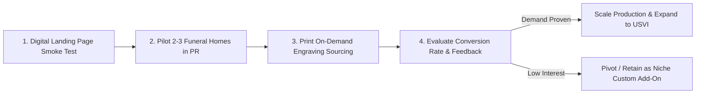
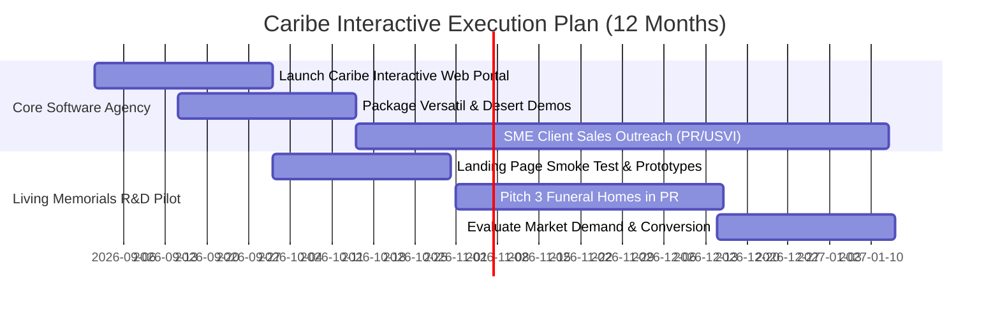

# 🚀 Business Plan: Caribe Interactive Solutions LLC
**AI-Accelerated Custom Business Solutions & R&D Market Explorations**
*Serving Puerto Rico & the US Virgin Islands (USVI)*

---

## 1. Executive Summary

### 1.1 Business Identity & Core Focus
**Caribe Interactive Solutions LLC** is a technology software and digital product studio headquartered in Puerto Rico, serving clients across Puerto Rico and the US Virgin Islands (St. Thomas, St. Croix, St. John).

Our primary core business is **AI-Accelerated Custom Digital Solutions**—building high-performance websites, interactive web applications, custom management admin portals, and companion mobile apps for small and medium-sized enterprises (SMEs). By leveraging modern AI engineering tools, Caribe Interactive cuts software development timelines by 60%–70% while providing businesses with full administrative data control.

Alongside our core software agency operations, Caribe Interactive maintains an **Innovation R&D Unit** to test niche product opportunities in the island market. The initial pilot concept being evaluated is **Living Memorials (QR Epitaphs)**—an experimental physical-digital memorial service linking cemetery visitors to cloud-hosted tribute pages.



### 1.2 Core Value Propositions

1. **Core Agency Service (Proven Demand)**: Delivering tailored business platforms (custom product wizards, WhatsApp order integration, real-time inventory, cost vs. price isolation, mobile notifications) at a fraction of traditional agency costs.
2. **Complete Data & Admin Autonomy**: Every business solution comes equipped with an internal Admin Portal allowing business owners to manage products, toggle price visibility, isolate internal costs from public prices, and track real-time orders.
3. **Experimental Exploration (Living Memorials)**: A low-risk, lean MVP approach to test whether island families and funeral directors will adopt digital epitaph technology before committing heavy capital.

---

## 2. Core Revenue Engine: AI-Accelerated Custom Business Solutions

Our core foundation is built on proven solutions like **Versatil Web Developments** and **Desert Website + App**. SMEs in Puerto Rico and USVI frequently lack accessible, custom-built tools to manage daily business data without expensive monthly SaaS fees.

### 2.1 Core Product & Service Matrix

| Solution Type | Technical Capabilities | Real-World Application Example |
| :--- | :--- | :--- |
| **Interactive Web Customizers** | Multi-step wizard builders, ingredient/topping pickers, dynamic price calculation, WhatsApp direct order forwarding. | **Versatil Web**: 5-step "Crear Mi Mezcla" custom drink builder for specialty beverage/dessert shops. |
| **Admin Control Portals** | Product CRUD operations, internal cost vs. public price isolation, inventory tracking, store settings configuration. | **Versatil Admin**: Hidden `/admin` dashboard allowing owners to hide public prices by default or toggle them ON anytime. |
| **Real-time Order & Notification Systems** | Node.js/Express Web API backend paired with native Android companion apps, custom audio chime generators, order queue dispatching. | **Desert Website + App**: Web app connected to `dessert-notifier` native Android app for instant store counter sound alerts. |
| **Bilingual Static & Dynamic Sites** | SSG (Static Site Generation), sub-second load times, local SEO optimization for PR/USVI search intent. | Launching showcase at **Caribe Interactive** parent platform. |

> [!NOTE]
> **Why Custom Admin Portals Win**: Generic platforms (Shopify, Squarespace) don't match local island workflows (e.g., custom WhatsApp ordering, internal cost isolation). Caribe Interactive fills this gap by delivering full custom web applications with built-in admin portals designed specifically for the client's day-to-day operations.

---

## 3. Experimental Pilot Concept: Living Memorials (QR Epitaphs)

> [!IMPORTANT]
> **Market Validation Notice**: Living Memorials is an **unproven product concept with unknown market demand**. Rather than investing heavily in machinery or inventory upfront, Caribe Interactive will execute a **Lean MVP Validation Strategy** to measure customer interest and partner conversion in Puerto Rico before scaling operations.

```
+-------------------------------------------------------------------------+
|                        EXPERIMENTAL CONCEPT OVERVIEW                    |
|   +-----------------------+                                             |
|   |  [ QR CODE MEDALLION ] |   Weatherproof QR plaque/medallion         |
|   |   Laser-Etched Metal  |   installed on headstone or memorial wall.  |
|   +-----------------------+                                             |
+-------------------------------------------------------------------------+
                                    |
                                    v [Smartphone Scan]
+-------------------------------------------------------------------------+
|                           DIGITAL TRIBUTE PAGE                          |
|  * Interactive Timeline   * Audio Voice Notes   * Bio & Obituary       |
|  * Photo Archive (15-500) * Video Documentaries * GPS Plot Navigation   |
|  * Moderated Condolences  * Password Vault      * Family Tree Link      |
+-------------------------------------------------------------------------+
```

### 3.1 Concept Product & Pricing Tiers (To Be Tested)

| Tier | Target Price | Digital Features | Physical Deliverable |
| :--- | :--- | :--- | :--- |
| **Simple Tribute** | **$79 – $99** *(One-time)* | Single-page biography, obituary, photo gallery (up to 15 photos), guestbook. | Anodized aluminum or marine-grade stainless steel QR plaque with heavy-duty 3M VHB outdoor adhesive. |
| **Living Legacy** | **$199 – $249** *(One-time)* | Multi-page site, interactive timeline, audio recordings, video embeds, family tree link, plot GPS. | Choice of brass/ceramic plaque or precision stencil & stone engraving coordination. |
| **Heritage Vault** | **$399+** *(One-time + cloud fee)* | Full archive: digitized letters, family recipes, private password-protected stories, documentary reel, lifetime host guarantee. | Custom-embedded bronze or granite-matched QR medallion installed on-site. |

---

### 3.2 Lean MVP Demand Validation Strategy

To test demand without incurring significant financial exposure:



1. **Smoke Testing & Pre-Orders**: Launch a targeted landing page showcasing video mockups of Living Memorials to gauge click-through rates and pre-order interest in PR.
2. **Funeral Director Interviews**: Pitch 3 to 5 local funeral home directors in San Juan and Caguas with physical prototype samples to test their willingness to offer it as an arrangement add-on.
3. **Print-on-Demand Sourcing**: Partner with existing laser etching job shops in Puerto Rico or US-based print-on-demand suppliers instead of purchasing laser engraving machinery upfront.
4. **Hosting Architecture**: Deploy cloud pages on low-cost edge infrastructure (Cloudflare Pages / AWS S3) with dynamic redirect vanity URLs (`memorial.io/firstname-lastname`), minimizing operational overhead to near zero (\(<\$0.01/\text{year}\) per site).

---

## 4. Comprehensive SWOT Analysis

To ensure strategic clarity, Caribe Interactive has conducted a **SWOT Analysis** evaluating internal strengths and weaknesses alongside external market opportunities and threats across Puerto Rico and the US Virgin Islands.

```
       +------------------------------------+------------------------------------+
       |             STRENGTHS              |             WEAKNESSES             |
       |  * 60-70% Faster AI Dev Workflows  |  * Unproven Living Memorial Demand |
       |  * Custom Admin Portals Included   |  * Early Startup Brand Awareness   |
       |  * Native Bilingual (ES/EN) Focus   |  * Initial External Etching Supply |
       |  * High Profit & Retainer Margins   |  * Lean Operational Team Size      |
       +------------------------------------+------------------------------------+
       |           OPPORTUNITIES            |              THREATS               |
       |  * 40,000+ PR SMEs Needing Apps    |  * Hurricane / Extreme Weather     |
       |  * PR Act 60 4% Export Incentives  |  * Low-Cost Generic DIY Builders   |
       |  * B2B Funeral Home Commission     |  * Cemetery Plaque Vandalism Risk  |
       |  * Municipal Heritage QR Trails    |  * Regional Economic Volatility    |
       +------------------------------------+------------------------------------+
```

### 4.1 Detailed Breakdown

#### 🟢 Strengths (Internal Advantages)
- **AI-Accelerated Engineering Engine**: Ability to turn around full-stack custom web applications and companion mobile apps in 3 to 7 days, giving us an insurmountable speed advantage over traditional agencies charging $5,000–$25,000.
- **Custom Admin Portals as Standard**: Unlike generic SaaS tools, every app comes with a tailored backend portal (product CRUD, internal cost vs. public price control, audio alerts, WhatsApp ordering) proven by reference apps ([Versatil](file:///C:/Users/insan/.gemini/antigravity/scratch/Verstail%20-%20Web) & [Desert](file:///C:/Users/insan/.gemini/antigravity/scratch/Dessert%20Website%20%2B%20App)).
- **Native Island Roots & Bilingual Capabilities**: Native fluency in Spanish and English aligned with PR and USVI commercial and cultural dynamics.
- **Low Overhead Infrastructure**: Utilizing static edge networks (Cloudflare Pages, AWS S3) yields near-zero hosting COGS (\(<\$0.01/\text{site}/\text{yr}\)), enabling ultra-high gross margins (>65%).

#### 🟡 Weaknesses (Internal Challenges)
- **Unproven Demand for Living Memorials**: QR Epitaphs represent an unvalidated product category in PR/USVI; consumer interest and funeral director willingness to upsell are currently unknown.
- **Brand Maturity & Initial Trust**: As a new market entrant, establishing credibility with traditional SME owners and conservative funeral home directors requires intensive face-to-face relationship building.
- **Reliance on Print-on-Demand Partners**: For the Living Memorial pilot, relying on third-party laser engravers creates slight lead time dependencies until sales volume justifies purchasing dedicated in-house fiber laser engravers.

#### 🔵 Opportunities (External Market Growth Drivers)
- **Mass SME Digital Adoption in PR & USVI**: Over 40,000 local businesses (eateries, bakeries, service providers) need modern webapps with WhatsApp integration to streamline sales without paying hefty delivery app commissions.
- **Puerto Rico Act 60 Export Tax Incentives**: Exporting custom software development services from Puerto Rico to USVI and US mainland clients qualifies for a 4% fixed corporate tax rate.
- **Untapped B2B Funeral & Cemetery Partnerships**: Funeral homes and monument makers actively seek new high-margin revenue streams; offering a 15–20% commission per Living Memorial creates an attractive passive add-on.
- **Municipal Digital Heritage & Tourism Trails**: Partnering with municipal historical trusts (San Juan, Ponce, Charlotte Amalie) to install QR historical markers on cemetery tombs of notable figures.

#### 🔴 Threats (External Environmental Risks)
- **Extreme Tropical Weather & Hurricanes**: Severe weather (Hurricane Maria/Fiona level events) risks damaging physical plaque installations and causing local power outages (mitigated by marine 316 stainless hardware, 3M VHB bonding, and serverless global cloud replication).
- **Inertia & Generic DIY Competitors**: Business owners relying on outdated social media pages or basic Wix/Squarespace templates without realizing the value of custom admin panels.
- **Plaque Vandalism or Wear**: Environmental degradation or physical damage to outdoor epitaph plaques (mitigated by lifetime physical replacement guarantees backed by low hardware unit costs).

---

### 4.2 Strategic TOWS Action Matrix

| Strategy Category | Actionable Execution Strategy |
| :--- | :--- |
| **SO Strategies** *(Leverage Strengths to Capture Opportunities)* | Use AI speed advantage to offer PR/USVI SMEs free 48-hour prototype demos of custom webapps with admin portals, securing monthly retainer contracts under Act 60 tax structures. |
| **WO Strategies** *(Overcome Weaknesses by Exploiting Opportunities)* | Mitigate Living Memorial demand uncertainty by leveraging funeral home partnerships (15-20% commission) to present prototypes directly to grieving families during arrangement meetings without spending on mass ads. |
| **ST Strategies** *(Use Strengths to Neutralize External Threats)* | Emphasize marine-grade 316 stainless steel and 3M industrial VHB epoxy durability to position Living Memorials as "Hurricane-Proof," outperforming cheap online acrylic stickers. |
| **WT Strategies** *(Minimize Weaknesses and Avoid External Threats)* | Maintain zero inventory overhead on Living Memorials by running an on-demand laser etching model until pilot conversion data proves sustained volume. |

---

## 5. Geographic & Market Context: PR & USVI

### 5.1 Market Dynamics

- **Puerto Rico Market**:
  - ~3.2M population with over 40,000 active small businesses.
  - High demand for affordable digital transformation (restaurants, food trucks, bakeries, retail).
  - Cultural emphasis on family heritage and remembrance (*Día de los Fieles Difuntos*, Father's/Mother's Day, Memorial Day).
- **US Virgin Islands (USVI) Market**:
  - St. Thomas, St. Croix, St. John.
  - Higher average transaction size and per-capita spending power.
  - High demand for bilingual (English/Spanish) digital services.

---

## 6. Financial Plan & 3-Year Projections

The financial model prioritizes **Custom Business Solutions** as the primary reliable income stream, with **Living Memorials** factored in as a conservative, low-overhead R&D expansion line.

### 6.1 Core Agency Services Pricing & Revenue

| Service Offering | Setup Fee | AI Dev Time | Admin Portal Included | Recurring Retainer |
| :--- | :--- | :--- | :--- | :--- |
| **Standard Business Webapp** | $950 - $1,500 | 8 - 15 Hours | Yes (Basic CRUD) | $75 / month |
| **Customizer & Order Webapp** (e.g. Versatil) | $1,800 - $3,200 | 15 - 30 Hours | Yes (Cost isolation + WhatsApp) | $125 / month |
| **Full Stack App + Android Notifier** (e.g. Desert) | $3,500 - $6,000 | 30 - 50 Hours | Yes (Full DB Admin + Mobile App) | $200 / month |

---

### 6.2 3-Year Consolidated Revenue Projections (USD)

```
Year 1 Core Revenue:  $95,000  (Agency Services) + $15,000 (Memorial Pilot) = $110,000
Year 2 Core Revenue: $180,000  (Agency Services) + $60,000 (Memorial Pilot) = $240,000
Year 3 Core Revenue: $320,000  (Agency Services) + $140,000 (Memorial Line) = $460,000
```

| Financial Metric | Year 1 (Launch & Pilot) | Year 2 (Growth) | Year 3 (Scale) |
| :--- | :--- | :--- | :--- |
| **Custom Agency Clients (Web/App)** | 25 Projects | 50 Projects | 85 Projects |
| Custom Software Setup Revenue | $65,000 | $140,000 | $245,000 |
| Recurring Admin Retainers (ARR) | $30,000 | $40,000 | $75,000 |
| **Living Memorial Pilot Sales (Units)** | *75 units (Validation)* | *300 units* | *700 units* |
| Living Memorial Pilot Revenue | $15,000 | $60,000 | $140,000 |
| **TOTAL GROSS REVENUE** | **$110,000** | **$240,000** | **$460,000** |
| Operating Expenses & Sourcing | $35,000 | $65,000 | $120,000 |
| **NET PROFIT BEFORE TAX** | **$75,000** | **$175,000** | **$340,000** |
| *Net Profit Margin* | *68.2%* | *72.9%* | *73.9%* |

---

## 7. Risk Management & Demand Validation Matrix

| Risk Factor | Risk Level | Mitigation Strategy |
| :--- | :--- | :--- |
| **Unproven Living Memorial Demand** | **High** | Execute lean MVP smoke test with zero capital expenditure on machinery; source on-demand plaque laser etching only when orders are received. |
| **Slow Funeral Home Adoption** | **Medium** | Test D2C retroactive marketing directly to families via social media before committing heavily to B2B funeral director commission deals. |
| **Client Software Scope Creep** | **Low** | Standardize component modules from reference apps ([Versatil](file:///C:/Users/insan/.gemini/antigravity/scratch/Verstail%20-%20Web) / [Desert](file:///C:/Users/insan/.gemini/antigravity/scratch/Dessert%20Website%20%2B%20App)) to ensure rapid AI delivery with strict scoping. |
| **PR Tax & Registration Requirements** | **Low** | Register LLC in PR, obtain SURI merchant registration, and structure USVI service exports under PR Act 60 incentives. |

---

## 8. Implementation Milestones



---
*Document updated with SWOT Analysis by Antigravity AI on 2026-08-29.*
